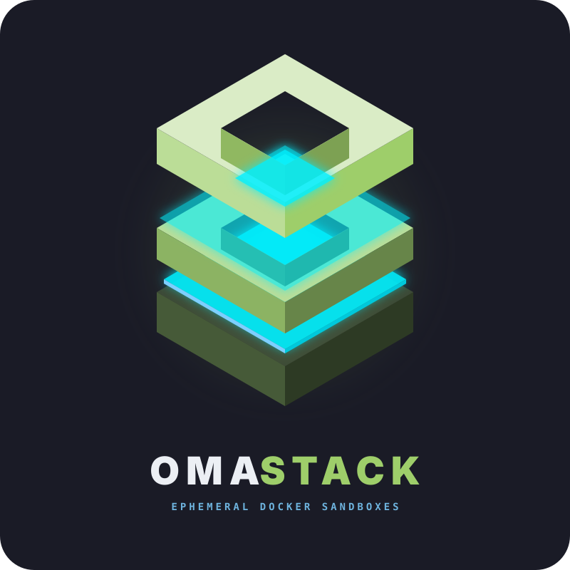

<p align="center">
  
</p>

# OmaStack (`omastack`)

> **Native, zero-bloat, keyboard-first ephemeral full-stack sandbox launcher and Docker environment manager built specifically for Omarchy Linux.**

[-1793d1?logo=arch-linux)](https://github.com/anax/omastack)
[](https://github.com/anax/omastack)
[](LICENSE)

---

## ⚡ Quick Start & Installation for Omarchy Linux

```text
╭─ anas@omarchy: ~ ─────────────────────────────────────────────────────────────────╮
│                                                                                   │
│  # 1. Install OmaStack via Omarchy Plugin Manager                                 │
│  ~ ❯ omarchy plugin add https://github.com/anax/omastack                          │
│  ✔ Added io.github.anax.omastack into ~/.config/omarchy/plugins/                  │
│  ✔ Enabled and loaded OmaStack top bar widget & CLI                               │
│                                                                                   │
│  # 2. First-time setup: Enable Docker daemon & user container permissions         │
│  ~ ❯ sudo systemctl enable --now docker                                           │
│  ~ ❯ sudo usermod -aG docker $USER && newgrp docker                               │
│                                                                                   │
│  # 3. Launch a full Next.js 14 + Postgres + Redis sandbox in 1 command!           │
│  ~ ❯ omastack up nextjs-postgres                                                  │
│  ⚡ [OmaStack] Initializing ephemeral sandbox: nextjs-postgres...                  │
│  ⚡ [OmaStack] Creating shared Docker network 'omastack-net'...                   │
│  ⚡ [OmaStack] Scanning local network ports with ss...                            │
│  ⚡ [OmaStack] Launching Docker Compose containers...                             │
│  ✔ [OmaStack] Connection variables copied to Wayland clipboard (wl-copy)!         │
│                                                                                   │
│  ✔ Ephemeral sandbox 'nextjs-postgres' is UP & READY!                             │
│  Active Endpoints:                                                                │
│    ➜ Web UI (NEXTJS):    http://localhost:3000                                    │
│    ➜ Web UI (ADMINER):   http://localhost:8080                                    │
│    ➜ Service (POSTGRES): localhost:5432                                           │
│    ➜ Service (REDIS):    localhost:6379                                           │
│                                                                                   │
│  🚀 Next.js App is live at:  http://localhost:3000                                │
│  🛠 Adminer DB UI is live at: http://localhost:8080                                │
│    ➜ To connect your local project: run omastack inject in your project root.     │
│                                                                                   │
╰───────────────────────────────────────────────────────────────────────────────────╯
```

### 📋 1. Prerequisites (First-Time Docker Setup)

OmaStack uses Docker to orchestrate ephemeral sandboxes. On Arch Linux and Omarchy, make sure the Docker daemon is enabled and your user account has container permissions:

```bash
# Start and enable the Docker background service
sudo systemctl enable --now docker

# Add your user to the docker group (allows running containers without sudo)
sudo usermod -aG docker $USER
newgrp docker   # Or log out and log back in
```

> [!TIP]
> If you see the desktop notification **"OmaStack: Docker Offline"**, simply run `sudo systemctl enable --now docker` to start the daemon.

---

### 🚀 2. 10-Second Quick Start (First Sandbox Launch)

Spin up a full Next.js 14 App Router + PostgreSQL 16 + Redis sandbox with one simple command:

```bash
omastack up nextjs-postgres
```

Open your browser immediately to access your running services:
* **Next.js Full-Stack App:** [http://localhost:3000](http://localhost:3000)
* **Adminer Database GUI:** [http://localhost:8080](http://localhost:8080)
* **PostgreSQL:** `localhost:5432` (`appuser` / `appdb`)
* **Redis:** `localhost:6379`

Connection credentials (`DATABASE_URL`, `REDIS_URL`) are automatically copied to your Wayland clipboard via `wl-copy`.

#### Connecting an existing project on your machine:
If you already have a Next.js or Laravel project in another directory:
```bash
cd ~/my-project
omastack inject   # Automatically appends database connection strings to .env
npm run dev
```

#### Stopping sandboxes:
```bash
omastack down nextjs-postgres    # Stop specific sandbox
omastack down --all              # Stop all sandboxes and immediately free system RAM
```

---

### 📥 3. Installation Methods for Omarchy Linux

#### Option 1: Omarchy Plugin Manager (Recommended)
```bash
omarchy plugin add https://github.com/anax/omastack
```

#### Option 2: Native Arch Linux Package (`pacman -U`)
Install the native pre-built package directly using `pacman`:

```bash
sudo pacman -U omastack-1.0.0-1-any.pkg.tar.zst
```

#### Option 3: Self-Extracting Offline Installer (`.run`)
Single standalone executable containing all 15 stack templates, CLI, and Quickshell widgets with zero network dependency:

```bash
chmod +x omastack-installer.run
./omastack-installer.run

# Optional flags:
./omastack-installer.run --test         # Run 40-step test suite
./omastack-installer.run --system       # Install system-wide to /usr/local
./omastack-installer.run --uninstall    # Cleanly remove
```

#### Option 4: Build from Source via `PKGBUILD` (`makepkg`)
```bash
git clone https://github.com/anax/omastack.git
cd omastack
makepkg -si
```

---

## 🔄 Updating OmaStack & Omarchy Plugin

To update OmaStack and its Omarchy desktop bar widget to the latest release:

```bash
# Method 1: Direct CLI self-updater (fastest)
omastack update

# Method 2: Via Omarchy Plugin Manager
omarchy plugin update omastack

# Method 3: If installed via Arch Linux pacman (.pkg.tar.zst)
sudo pacman -U https://github.com/anax/omastack/releases/latest/download/omastack-1.0.0-1-any.pkg.tar.zst
```

### 📦 Building Release Packages Locally
To rebuild all installable packages (`.pkg.tar.zst`, `.run`, and `.tar.gz`) into `dist/`:

```bash
./package.sh
```

### 🗑️ Safe Removal & Uninstallation

To cleanly remove OmaStack and tear down all active sandboxes:

```bash
# Option 1: Via Omarchy Plugin Manager (Recommended)
omarchy plugin remove io.github.anax.omastack

# Option 2: Run local uninstaller script
~/.config/omarchy/plugins/io.github.anax.omastack/install.sh --uninstall

# Option 3: Manual removal
omastack down --all
rm -f ~/.local/bin/omastack
rm -rf ~/.local/share/omastack ~/.config/omarchy/plugins/io.github.anax.omastack ~/.config/omarchy/widgets/omastack.json
```

---

## 🚀 Key Features

* **Ephemeral Curated Stacks:** Spin up multi-service stacks (`alpine`-based where possible) in seconds.
* **Zero Port Conflicts (`ss -tuln`):** Automatically scans host sockets before launching. If a port (e.g., `5432` or `3306`) is in use, OmaStack dynamically rebinds to an available port without manual tweaking.
* **Wayland Clipboard & `.env` Sync:** Formats connection strings (`DATABASE_URL`, `REDIS_URL`, etc.) and copies them immediately to the Wayland clipboard via `wl-copy`. Safely backs up `.env` to `.env.omastack.bak` before merging.
* **Local Trusted HTTPS (`*.oma.local`):** Automatically provisions trusted SSL certificates using `mkcert` and routes local hostnames (`https://mail.oma.local`, `https://n8n.oma.local`, `https://db.oma.local`) through an embedded Caddy reverse proxy.
* **Omarchy Desktop Integration:**
  * **Widget Panel Shortcut:** Press <kbd>Super</kbd> + <kbd>Alt</kbd> + <kbd>W</kbd> to open the live sandbox Widget Panel (`omastack widget` / `omastack panel`).
  * **Hyprland Shortcut:** Press <kbd>Super</kbd> + <kbd>Alt</kbd> + <kbd>Space</kbd> to open the Walker/Rofi launcher anywhere.
  * **Waybar Module:** Real-time status indicator (`{"text": "⚡ 2", "tooltip": "...", "class": "active"}`). Left-click opens the menu; right-click tears down all active stacks to free RAM instantly.
  * **Theme Synchronization:** Adapts colors dynamically to your current Omarchy palette (Tokyo Night, Catppuccin Mocha, Gruvbox, Rosé Pine, Nordic, Cyberpunk).

---

## 📦 Pre-Configured Stack Templates

Templates are stored in `~/.local/share/omastack/templates/`:

| Template ID | Included Services | Default Ports | Local HTTPS Domain |
| :--- | :--- | :--- | :--- |
| **`laravel-stack`** | MySQL 8.0, Redis Alpine, Mailpit (SMTP), Meilisearch | `3306`, `6379`, `8025`, `7700` | `https://mail.oma.local`<br>`https://search.oma.local` |
| **`supabase-lite`** | PostgreSQL 16 (`pgvector`), PostgREST, PgAdmin | `5432`, `3000`, `5051` | `https://supabase.oma.local`<br>`https://api.supabase.oma.local` |
| **`nextjs-postgres`** | Next.js 14 App Router, PostgreSQL 16, Redis Alpine, Adminer UI | `3000`, `5432`, `6379`, `8080` | `https://next.oma.local`<br>`https://db.oma.local` |
| **`rails-kamal`** | PostgreSQL 16, Redis/SolidQueue, Mailpit, MinIO S3 | `5432`, `6379`, `8025`, `9000`, `9001` | `https://rails-mail.oma.local`<br>`https://s3.oma.local` |
| **`django-celery`** | PostgreSQL 16, Redis Broker, Flower Celery UI, Mailpit | `5432`, `6379`, `5555`, `8025`, `1025` | `https://flower.oma.local`<br>`https://django-mail.oma.local` |
| **`ai-rag-stack`** | Qdrant Vector DB, PostgreSQL 16 (`pgvector`), Redis | `6333`, `6334`, `5432`, `6379` | `https://qdrant.oma.local` |
| **`mern-mongo`** | MongoDB 7, Mongo Express Web UI, Redis Alpine | `27017`, `8081`, `6379` | `https://mongo.oma.local` |
| **`golang-microservices`** | RabbitMQ 3 Management, Jaeger Tracing, PostgreSQL 16, Redis | `5672`, `15672`, `16686`, `4318`, `5432`, `6379` | `https://amqp.oma.local`<br>`https://trace.oma.local` |
| **`observability-lgtm`** | Grafana Dashboards, Prometheus Metrics, Loki Logs, Redis | `3001`, `9090`, `3100`, `6379` | `https://grafana.oma.local`<br>`https://prometheus.oma.local` |
| **`clickhouse-analytics`** | ClickHouse OLAP DB, Redpanda Kafka Console, Redis | `8123`, `9009`, `8082`, `6379` | `https://clickhouse.oma.local`<br>`https://kafka.oma.local` |
| **`keycloak-iam`** | Keycloak 24 OIDC/OAuth2 IAM, PostgreSQL 16, Mailpit | `8084`, `5432`, `8025`, `1025` | `https://auth.oma.local`<br>`https://auth-mail.oma.local` |
| **`directus-cms`** | Directus 11 Headless CMS & Data Studio, PostgreSQL 16, Redis | `8055`, `5432`, `6379` | `https://cms.oma.local` |
| **`wordpress-mariadb`** | MariaDB 11, Redis Object Cache, phpMyAdmin UI, Mailpit | `3306`, `6379`, `8083`, `8025`, `1025` | `https://pma.oma.local`<br>`https://wp-mail.oma.local` |
| **`automation-hub`** | n8n Workflow Automation, PostgreSQL 16, Redis Queue | `5678`, `5432`, `6379` | `https://n8n.oma.local` |
| **`web3-node`** | EVM RPC Proxy (Anvil/Hardhat), PostgreSQL 16, Redis | `8545`, `5432`, `6379` | `https://rpc.oma.local` |

---

## ⌨️ CLI Usage

```bash
# Spin up a stack template
omastack up laravel-stack

# Stop a specific running stack
omastack down laravel-stack

# Teardown all running sandboxes and immediately free system RAM
omastack down --all

# List active sandboxes, memory usage, and port allocations
omastack list

# Launch interactive keyboard menu (Walker / Rofi / fzf / gum)
omastack menu

# Launch live Omarchy Widget Panel
omastack widget
omastack widget --json
omastack panel

# Output Waybar single-line JSON module payload
omastack status --waybar

# Inject connection strings into current directory .env (with .env.omastack.bak backup)
omastack inject

# Tail real-time container logs
omastack logs laravel-stack

# Reload Caddy reverse proxy mappings
omastack proxy
```

---

## 🖥️ Waybar Integration

Add this module to your `~/.config/waybar/config.jsonc`:

```jsonc
"custom/omastack": {
    "format": "{}",
    "exec": "omastack status --waybar",
    "return-type": "json",
    "interval": 5,
    "on-click": "omastack menu",
    "on-click-right": "omastack down --all",
    "tooltip": true
}
```

Add styling to your `~/.config/waybar/style.css`:

```css
#custom-omastack.active {
    color: #7dcfff;
    background-color: rgba(125, 207, 255, 0.15);
    border-radius: 8px;
    padding: 0 10px;
}

#custom-omastack.idle {
    color: #565f89;
}
```

---

## 🔧 Troubleshooting & Frequently Asked Questions (FAQ)

### ❓ 1. Why do I see the "OmaStack: Docker Offline" notification?
* **Cause:** The Docker daemon background service (`docker.service`) is not running or your user account lacks container execution permissions.
* **Fix:** Run the following commands in your terminal:
  ```bash
  sudo systemctl enable --now docker
  sudo usermod -aG docker $USER
  newgrp docker
  ```
  *(OmaStack will also attempt to auto-start Docker using systemctl or Polkit desktop elevation)*.

### ❓ 2. How do I access localhost services after running `omastack up`?
* When you launch a stack (e.g., `omastack up nextjs-postgres`), services bind directly to your host machine:
  * **Web Applications:** Open `http://localhost:3000` (Next.js), `http://localhost:8080` (Adminer DB GUI), `http://localhost:8025` (Mailpit).
  * **Database Sockets:** Connect directly via `127.0.0.1:5432` (Postgres), `127.0.0.1:3306` (MySQL), or `127.0.0.1:6379` (Redis).
  * **Active Endpoints:** Run `omastack list` to view all active endpoints and ports at any time.

### ❓ 3. How do I open the graphical panel in Omarchy?
* **Top Bar Icon:** Click the ⚡ lightning bolt icon in the Omarchy Quattro top bar.
* **Shortcut:** Press <kbd>Super</kbd> + <kbd>Alt</kbd> + <kbd>W</kbd> anywhere on your desktop.
* **Walker Searchable Menu:** Press <kbd>Super</kbd> + <kbd>Alt</kbd> + <kbd>Space</kbd> to launch, restart, or inspect sandboxes from a fuzzy finder.

### ❓ 4. What happens if a port (e.g., 5432 or 3000) is already in use?
* OmaStack includes an automatic socket scanner (`ss -tuln`). If a port is occupied by another local service, OmaStack **automatically detects the collision, rebinds to an available port, and updates your connection string**. You will never see a hard Docker Compose port collision crash.

### ❓ 5. How do I connect my existing project on my machine?
* You don't need to manually configure passwords or hostnames. Just navigate to your local codebase and run:
  ```bash
  cd ~/dev/my-project
  omastack inject
  ```
  OmaStack safely backs up your existing `.env` to `.env.omastack.bak` and appends the live credentials (`DATABASE_URL`, `REDIS_URL`, etc.).

### ❓ 6. How do I completely stop sandboxes and reclaim system RAM?
```bash
# Stop a single sandbox
omastack down nextjs-postgres

# Stop all active sandboxes and reclaim 100% of container memory
omastack down --all
```
*(Or simply right-click the OmaStack Waybar module).*

---

## 🗂️ Repository Structure

```text
omastack/
├── bin/
│   ├── omastack                  # Main executable CLI & menu dispatcher
│   └── omarchy                   # Omarchy System & Plugin Manager
├── lib/
│   ├── core.sh                   # Logging, dependency checks, state tracking
│   ├── docker.sh                 # Compose wrappers, healthchecks, RAM stats, port scanner
│   ├── env.sh                    # .env parser, injector, and wl-copy formatter
│   ├── proxy.sh                  # Caddy + mkcert *.oma.local domain manager
│   ├── theme.sh                  # Reads Omarchy active theme colors for fzf/gum
│   └── ui.sh                     # Walker/Rofi dmenu mode & terminal TUI menus
├── templates/
│   ├── laravel-stack/
│   │   ├── docker-compose.yml
│   │   └── stack.conf
│   ├── supabase-lite/
│   ├── nextjs-postgres/
│   ├── automation-hub/
│   └── web3-node/
├── omastore.toml                 # OmaStore 1-click manifest
├── install.sh                    # Self-installer script
└── README.md
```

---

## 📄 License & Credits

Built for **Omarchy Linux** by the Omarchy DevOps Team.  
Repository: [https://github.com/anax/omastack](https://github.com/anax/omastack)  
Licensed under the [MIT License](LICENSE).
